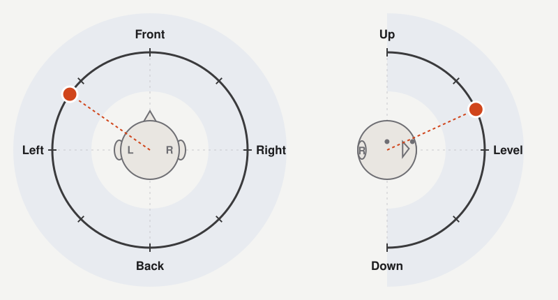

# binaural-loc

A listening-test tool for binaural sound localization. Listeners hear a sound
over headphones and click where it came from: direction in a top view, height
in a side view.



It was made to compare HRTF reconstruction methods against measured HRTFs.
Reconstruction errors show up mostly in elevation and front/back judgements,
and reporting those as numbers is hard for untrained listeners.

- Stimuli are WAV files rendered beforehand. The browser only plays them and
  records answers.
- Trial lists are generated in Python from a seed.
- The browser never sees condition names or, in the main blocks, target
  directions.
- Every answer is written to disk before the next trial, and an interrupted
  session can be resumed.
- Runs locally on one computer. No head tracking, no online use.

## Install

Needs Python 3.10+ and Node.js 20.19+ (only to build the front end).

```bash
./setup.sh
```

## Demo

```bash
.venv/bin/python examples/demo/run.py
```

On macOS you can also double-click `start_demo.command`. Use participant
`P01` to `P04` and any session ID. The demo sounds contain only ITD and ILD, so
front/back and elevation cannot be heard.

`run.py --simulate` generates answers from simulated listeners and analyses
them.

## Your own experiment

1. Render stereo WAVs (left ear first) at one sample rate.
2. Write a manifest CSV (below).
3. Copy [examples/demo/experiment.yaml](examples/demo/experiment.yaml) and edit it.
4. Then:

```bash
.venv/bin/python -m binaural_loc design  --config experiment.yaml   # trial lists
.venv/bin/python -m binaural_loc check   --config experiment.yaml   # validate everything
.venv/bin/python -m binaural_loc serve   --config experiment.yaml   # http://127.0.0.1:8000
.venv/bin/python -m binaural_loc analyze --config experiment.yaml --by participant_id,condition
```

## Coordinates

Same as SOFA `SimpleFreeFieldHRIR`: azimuth 0° is front and +90° is left;
elevation 0° is horizontal and +90° is up. Responses have azimuth in [0°, 360°).

The half-circle in the side view stands for the azimuth chosen in the top view,
and the head turns with it. For a sound directly to the left at ear height,
click Left and then Level.

## Session

Participant and session ID, left/right check, volume, instructions, practice
with feedback, main blocks with breaks. A session cannot start if the output
device does not run at the sample rate of the stimuli, because the browser would
resample without saying so.

Sounds play once; replays can be allowed with `max_replays`. Answers are enabled
after playback. Reaction time runs from the end of the first playback to
Confirm. To resume, enter the same IDs again.

## Files

**Manifest** (CSV): `stimulus_id, file_path, target_azimuth, target_elevation`
and any other columns, which are copied to the results. Paths are relative to
the manifest.

**Trial list** (CSV): `participant_id, block, trial_index, stimulus_id,
is_training, is_catch, list_seed`. One file per participant, `P01.csv`, or
`P01_S2.csv` for a particular session. `design` writes these; you can also make
them yourself. Each repetition contains every main stimulus once in random
order. Existing lists are not changed unless you pass `--force`.

**Results**: `results/P01_S1.jsonl`, one line per answer, without targets or
errors. The checks, breaks and device information are in
`results/P01_S1.events.jsonl`. `n_azimuth_clicks` and `n_elevation_clicks`
include the first click. The externalization rating, if enabled, counts from 1
in the order of the labels.

**Config** (YAML): see the demo. All participant texts can be replaced under
`text:`; the keys are in [binaural_loc/config.py](binaural_loc/config.py).

## Analysis

`analyze` writes `trials.csv` (one row per trial) and `summary.csv` (n, mean,
median, rms and sd per group) to `results/analysis/`. Practice and catch trials
are left out by default. Incomplete sessions are included and there is no
outlier removal, so keep pilot and test data out of the results folder.

| column | meaning |
|---|---|
| `azimuth_error`, `elevation_error` | response − target, azimuth wrapped to [−180°, 180°) |
| `great_circle_error` | angle between response and target |
| `lateral_error` | response − target lateral angle |
| `polar_error` | response − target polar angle, wrapped; only targets within ±30° lateral |
| `quadrant_error` | 1 if the polar error exceeds 90° |
| `local_polar_error` | polar error of the remaining trials |
| `front_back_confusion` | 1 if the response is on the wrong side of the frontal plane; not defined for targets within 10° of it |
| `..._fb_resolved` | error after mirroring front/back confusions |

Lateral and polar angles are interaural-polar: lateral −90° to 90° (left
positive), polar −90° to 270° (front 0°, up 90°, back 180°). The mean of
`quadrant_error` is the quadrant error rate, and the rms of `local_polar_error`
is the local polar RMS error. Include enough targets near the median plane, as
only those within ±30° count here.

The 90° and ±30° limits correspond to `querrMiddlebrooks` and `rmsPmedianlocal`
in the [Auditory Modeling Toolbox](http://amtoolbox.org/amt-1.5.0/doc/common/localizationerror.php),
after Middlebrooks (1999), *J. Acoust. Soc. Am.* 106(3), 1493–1510. Other papers
define quadrant errors differently (AMT's `querr` uses laterally weighted errors
above 45°), so check before comparing numbers. The 10° limit is our own choice.
All three are parameters of `add_trial_metrics`.

In azimuth-only sessions the response elevation counts as 0°.

## In the lab

- Set the output device to the sample rate of the stimuli.
- Turn off spatial audio, EQ, loudness normalisation and system sounds.
- Use the same wired headphones and volume for everyone.
- Do the left/right check in every session.
- Use codes as participant IDs, not names.
- Back up the results folder; it is not under version control.

## Development

```bash
.venv/bin/pytest
npm --prefix binaural_loc/web test
npm --prefix binaural_loc/web run dev    # expects `binaural_loc serve` on port 8000
```

## License

MIT
